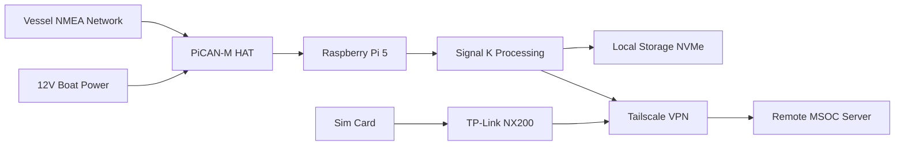
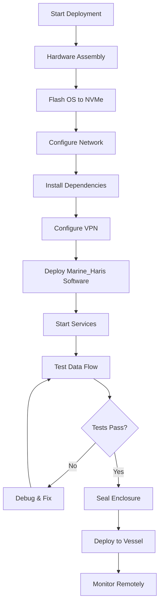

# Marine_Haris: Maritime Security Data Collector


> **"Marine_Haris"** - Your vigilant guardian for maritime security data collection. 
> Named from Arabic "Haris" (حارس) meaning "guardian" or "protector".

## 🎯 **Project Overview**

Marine_Haris is an edge computing device designed for **Maritime Security Operations Centers (MSOC)** to collect, process, and transmit vessel data securely. It acts as a sentinel watching over maritime networks, gathering NMEA 2000/0183 data and transmitting it via encrypted VPN to a central operations center.

### **Key Features**
- ✅ **NMEA 2000 & NMEA 0183 data collection** via PiCAN-M HAT
- ✅ **Secure VPN transmission** using Tailscale
- ✅ **Edge processing** with Raspberry Pi 5 + NVMe storage
- ✅ **Real-time data synchronization** to remote servers
- ✅ **Tamper-evident design** for security operations
- ✅ **Open-source architecture** for transparency and auditability

## ⚙️ **Hardware Components**

| Component | Specification | Purpose |
|-----------|--------------|---------|
| **Raspberry Pi 5** | 16GB RAM | Main processing unit |
| **PiCAN-M HAT** | Marine-grade CAN bus | NMEA 2000/0183 connectivity |
| **Storage** | 128GB NVMe SSD | Local data storage and processing |
| **Connectivity** | TP-Link Archer NX200 | Cellular internet with VPN client |
| **Power** | 12V boat system | SMPS power from NMEA backbone |

## 🚀 **Quick Start Guide**

### **Prerequisites**
- Raspberry Pi OS (64-bit) on NVMe SSD
- PiCAN-M HAT properly installed
- NMEA network access on vessel
- Remote server with public IP

### **Installation Steps**
1. **Clone the repository**
   ```bash
   git clone https://github.com/ahmdngi/Marine_Haris.git
   cd Marine_Haris
   ```

2. **Configure hardware**
   ```bash
   # Enable CAN interface
   sudo ./config/system/enable_can.sh
   ```

3. **Set up VPN connection**
   ```bash
   # Configure Tailscale
   sudo ./config/tailscale/setup.sh
   ```

4. **Start data collection**
   ```bash
   # Install and start services
   sudo ./src/system/install_services.sh
   ```

## 📊 **System Architecture**



## 🔒 **Security Features**

- **End-to-end encryption** via Tailscale (WireGuard-based)
- **Tamper-evident seals** and monitoring
- **Secure boot** with NVMe encryption
- **Automatic data wipe** on compromise detection
- **Network isolation** with firewall rules

## 📖 **Documentation**

- [Installation Guide](docs/INSTALLATION.md)
- [VPN Setup Instructions](docs/VPN_SETUP.md)
- [Security Policy](docs/SECURITY_POLICY.md)
- [Hardware Assembly](hardware/ASSEMBLY_GUIDE.md)

## 🚀 **Deployment Workflow**




## 🤝 **Contributing**

We welcome contributions from the maritime security community. Please read our [Contributing Guidelines](CONTRIBUTING.md) before submitting PRs.

## 📄 **License**

This project is licensed under the MIT License - see the [LICENSE](LICENSE) file for details.

## 📞 **Support**

For technical support or security concerns, contact: haris@ahmdngi.io

---

**⚠️ Notice**: This system is for authorized maritime security operations only. Unauthorized use is prohibited.
