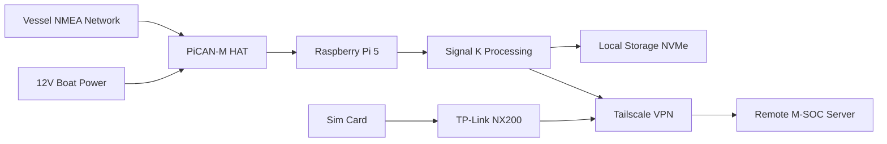
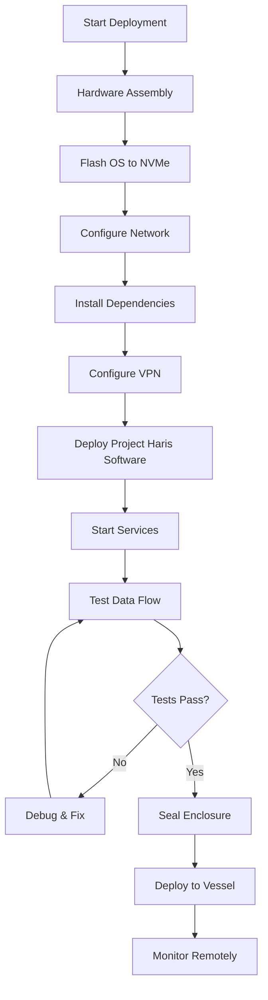

# Project Haris: Maritime Security Data Collector

[]()
[](https://github.com/project-haris/marine-haris)

> **"Project Haris"** - Your vigilant guardian for maritime security data collection. 
> Named from Arabic "Haris" (حارس) meaning "guardian" or "protector".

## 🎯 **Project Overview**

Project Haris is an edge computing device designed for **Maritime Security Operations Centers (M-SOC)** to collect, process, and transmit vessel data securely. It acts as a sentinel watching over maritime networks, gathering NMEA 2000/0183 data and transmitting it via encrypted VPN to a central operations center.

### **Key Features**
- ✅ **NMEA 2000 & NMEA 0183 data collection** via PiCAN-M HAT
- ✅ **Secure VPN transmission** using Tailscale
- ✅ **Edge processing** with Raspberry Pi 5 + NVMe storage
- ✅ **Real-time data synchronization** to remote servers
- ✅ **Tamper-evident design** for security operations
- ✅ **Open-source architecture** for transparency and auditability

## ⚙️ **Hardware Components**

| Component | Specification | Purpose |
|-----------|--------------|---------|
| **Raspberry Pi 5** | 16GB RAM | Main processing unit |
| **PiCAN-M HAT** | Marine-grade CAN bus | NMEA 2000/0183 connectivity |
| **Storage** | 128GB NVMe SSD | Local data storage and processing |
| **Connectivity** | TP-Link Archer NX200 | Cellular internet with VPN client |
| **Power** | 12V boat system | SMPS power from NMEA backbone |

## 🚀 **Quick Start Guide**

### **Prerequisites**
- Raspberry Pi OS (64-bit) on NVMe SSD
- PiCAN-M HAT properly installed
- NMEA network access on vessel
- Remote server with public IP

### **Installation Steps**

The production deployment path is **[watchtower](https://github.com/project-haris/watchtower)** (Project Haris Ansible automation): hardware assembly → OS flash → then `ansible-playbook playbooks/group_vessel_edge/main.yml` provisions Signal K, the `harisd` collector, Filebeat, and Tailscale. This repo is the collector source; `src/system/harisd.service` is a reference copy of the systemd unit (the deployed unit is rendered by watchtower's `harisd.service.j2` template).

For a manual/bench install of the collector alone:

1. **Clone the repository**
   ```bash
   git clone https://github.com/project-haris/marine-haris.git
   cd marine-haris
   ```

2. **Enable the CAN interface** (NMEA 2000 via PiCAN-M HAT)
   ```bash
   # bring up can0 at 250 kbit/s (or use watchtower's haris role, which manages this)
   sudo ip link set can0 up type can bitrate 250000
   ```

3. **Set up the Tailscale VPN**
   ```bash
   # Configure Tailscale
   sudo ./config/tailscale/setup.sh
   ```

4. **Install and start the collector service**
   ```bash
   # install the harisd systemd unit manually, or let watchtower deploy it
   sudo cp src/system/harisd.service /etc/systemd/system/
   sudo systemctl daemon-reload
   sudo systemctl enable --now harisd
   ```

## 📊 **System Architecture**

> **Interactive architecture diagram:** [`docs/architecture-marine-haris.html`](docs/architecture-marine-haris.html) — archify-generated (dark/light themes, PNG/SVG export). Source spec: [`docs/architecture-marine-haris.json`](docs/architecture-marine-haris.json).



## 🔒 **Security Features**

- **End-to-end encryption** via Tailscale (WireGuard-based)
- **Tamper-evident seals** and monitoring
- **Secure boot** with NVMe encryption
- **Automatic data wipe** on compromise detection
- **Network isolation** with firewall rules

## 📖 **Documentation**

- [Installation Guide](docs/INSTALLATION.md)
- [VPN Setup Instructions](docs/VPN_SETUP.md)
- [Security Policy](docs/SECURITY_POLICY.md)
- [Hardware Assembly](hardware/ASSEMBLY_GUIDE.md)

## 🚀 **Deployment Workflow**




## 📦 **Deployment**

Fleet deployment is automated by **watchtower** — see its README for the playbook commands. The flow: assemble hardware → flash OpenPlotter/RPi OS → run the vessel-edge playbook over Tailscale.

## 📄 **License**

This project is licensed under the MIT License - see the [LICENSE](LICENSE) file for details.

## 📞 **Support**

For technical support or security concerns, contact: haris@ahmdngi.io

---

**⚠️ Notice**: This system is for authorized maritime security operations only. Unauthorized use is prohibited.
