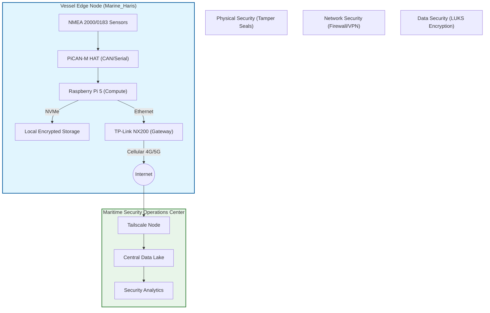
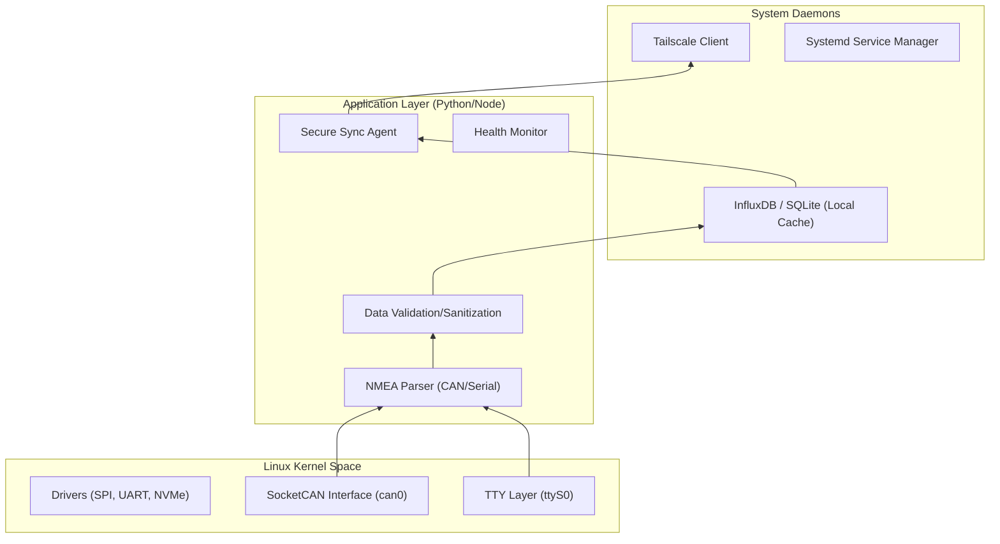
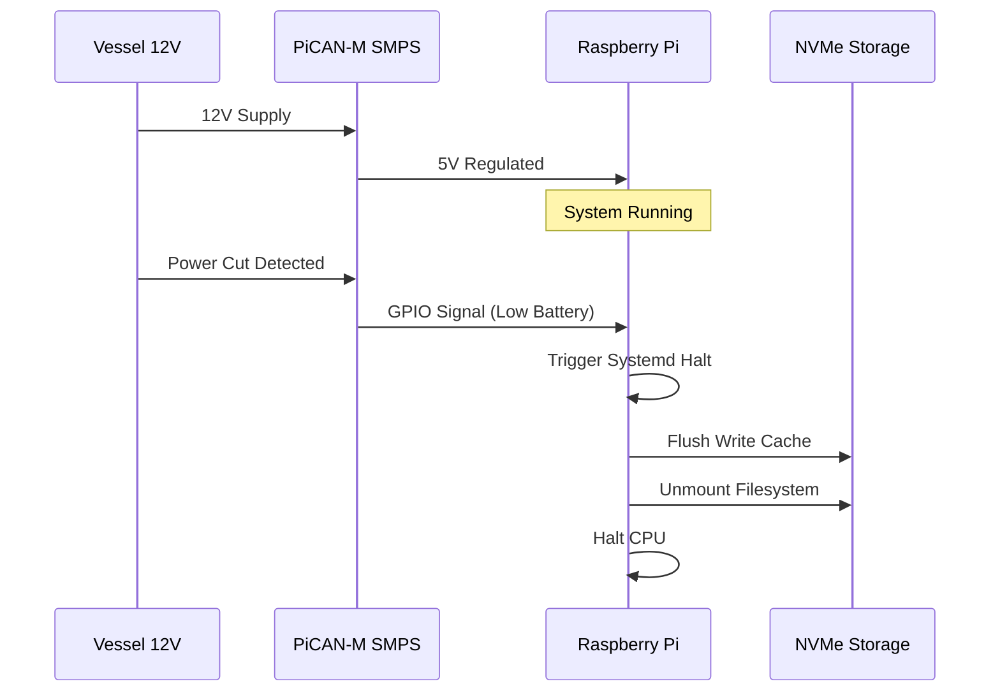

# Architecture Overview: Marine_Haris

## 1. System Philosophy

The **Marine_Haris** architecture is built on the principle of **Edge Computing** combined with **Secure Tunneling**. Unlike traditional IoT devices that rely on cloud processing, Marine_Haris processes high-bandwidth NMEA data locally on the vessel, transmitting only relevant, processed, or buffered data to the Maritime Security Operations Center (MSOC). This reduces latency, lowers cellular data costs, and ensures operation during connectivity blackouts.

## 2. High-Level Architecture Diagram



## 3. Component Architecture

### 3.1 Hardware Layer
The hardware is selected for performance, power efficiency, and marine compatibility.

| Component | Role | Architecture Notes |
| :--- | :--- | :--- |
| **Raspberry Pi 5 (16GB)** | Compute Node | Handles concurrent NMEA parsing, database operations, and VPN encryption. 16GB RAM allows for significant data buffering. |
| **PiCAN-M HAT** | Interface Layer | Provides the physical layer translation between NMEA 2000 (CAN Bus) and the Pi's SPI interface. Includes SMPS for power regulation. |
| **NVMe SSD (128GB)** | Storage Layer | High-speed storage for the OS, logs, and raw data buffers. Faster than SD cards, crucial for database IOPS. |
| **TP-Link NX200** | Gateway Layer | Acts as the cellular modem. Provides NAT and network connectivity for Tailscale. |

### 3.2 Software Stack
The software architecture uses a layered approach, separating hardware drivers from application logic.



## 4. Network Architecture & Security

### 4.1 Network Topology
The device creates a secure enclave on the vessel.
*   **Internal Interface (`eth0`)**: Connects to the PiCAN-M and local processing logic.
*   **External Interface (`wlan0` / `eth1`)**: Connects to the TP-Link Router.
*   **VPN Interface (`tailscale0`)**: A virtual network interface created by Tailscale.

### 4.2 The "Air-Gapped" VPN Model
Communication is designed to be **Fail-Closed**.
1.  **Initiation**: The Raspberry Pi (or Router) initiates an outbound connection via Tailscale.
2.  **Encryption**: All TCP/UDP traffic is encapsulated within the Tailscale tunnel (WireGuard-based).
3.  **Isolation**: The MSOC sees the device as a Tailscale IP address (e.g., `100.x.x.x`), effectively bypassing the public internet's routing tables for internal services.

### 4.3 Firewall Logic (firewalld)
The Raspberry Pi enforces strict traffic rules using firewalld:
```bash
# Default Zone: drop (deny all incoming)
# Trusted Zone: tailscale (allow from Tailscale interface)

# Allow SSH only via Tailscale
firewall-cmd --permanent --zone=tailscale --add-service=ssh

# Allow Signal K API via Tailscale
firewall-cmd --permanent --zone=tailscale --add-port=3000/tcp
```

## 5. Data Pipeline

The data flow is designed for resilience in low-bandwidth environments.

1.  **Collection**: 
    *   **NMEA 2000**: The kernel `SocketCAN` driver reads raw frames from `can0`.
    *   **NMEA 0183**: The kernel `TTY` driver reads serial data from `/dev/ttyS0`.
2.  **Ingestion**:
    *   The `harisd` daemon reads these streams.
    *   PGNs (Parameter Group Numbers) are decoded into JSON objects.
3.  **Processing**:
    *   Data is validated (checksums, sanity checks).
    *   Data is aggregated (e.g., averaging GPS position over 10 seconds).
    *   Data is tagged with the vessel ID and timestamp.
4.  **Storage (Buffer)**:
    *   Processed data is written to the local NVMe database (InfluxDB).
    *   This acts as a buffer; if the internet fails, data is safely stored locally.
5.  **Transmission**:
    *   The `sync_agent` attempts to push data to the MSOC via the VPN.
    *   Uses **rsync-over-SSH** or **HTTP POST** to a secure endpoint.
    *   Upon successful receipt confirmation by the MSOC, local data is flagged for deletion or archival.

## 6. Power Management

The architecture includes a "Graceful Shutdown" mechanism to prevent data corruption during power loss.



## 7. Physical Deployment Topology

For the **Marine_Haris** device to be effective, its placement on the vessel's network is critical.

*   **Placement**: Installed in a protected, dry location (bridge or electronics room).
*   **Connection**: Connected to the NMEA 2000 **Backbone** via a Drop Cable.
*   **Isolation**: The device is passive on the NMEA network (listen-only) to ensure it does not interfere with critical navigation systems.

---

*This architecture ensures that Marine_Haris is not just a data collector, but a secure, resilient computing node capable of operating in the harsh and variable conditions of maritime environments.*