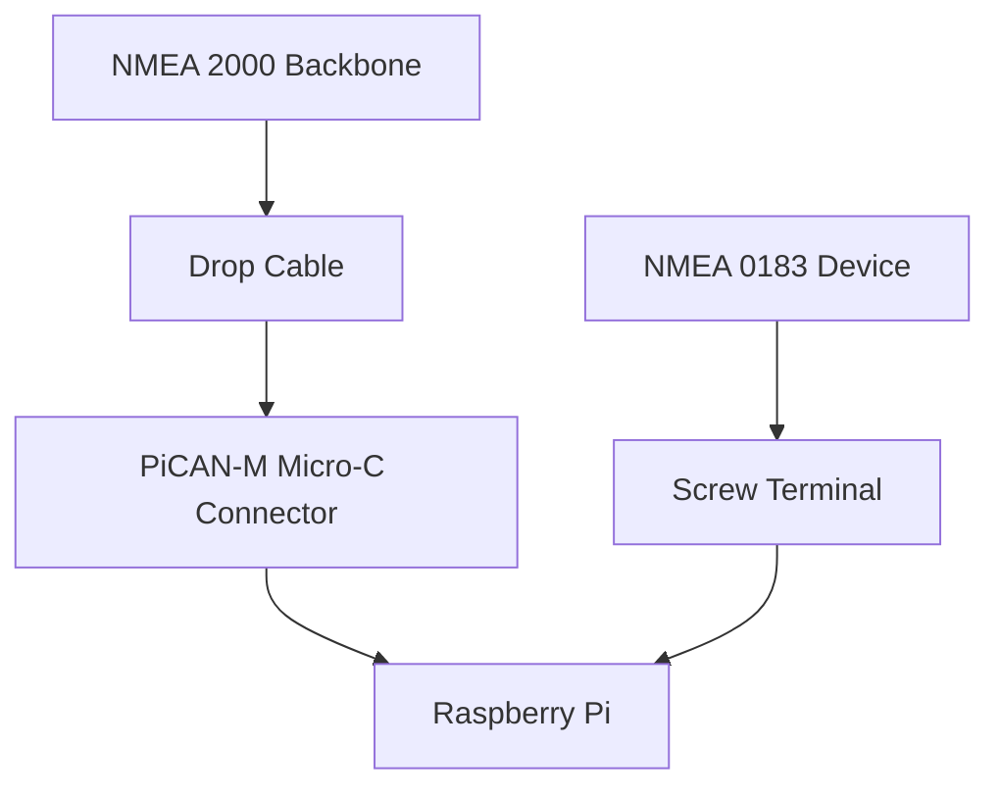

# Installation Guide

## 📋 **Prerequisites Checklist**

Before starting installation, ensure you have:

- [ ] Raspberry Pi 5 (16GB recommended)
- [ ] PiCAN-M HAT with standoffs and screws
- [ ] 128GB NVMe SSD with Pimoroni NVMe Base
- [ ] TP-Link Archer NX200 with active SIM card
- [ ] NMEA 2000/0183 network access on vessel
- [ ] Remote server with public IP
- [ ] Basic Linux command line knowledge

## 🔧 **Step 1: Hardware Assembly**

### **1.1 Mount the PiCAN-M HAT**
1. Power off Raspberry Pi
2. Align 40-pin header with GPIO pins
3. Secure with standoffs and screws
4. Ensure proper seating

### **1.2 Connect NMEA Network**


**NMEA 2000 Wiring:**
| Pin | Signal | Wire Color |
|-----|--------|-----------|
| 1 | Shield | Bare/Drain |
| 2 | +12V | Red |
| 3 | GND | Black |
| 4 | CAN_H | White |
| 5 | CAN_L | Blue |

**NMEA 0183 Wiring:**
| Terminal | Signal | Connection |
|----------|--------|------------|
| IN- | Ground | RS-422 TX- |
| IN+ | Input+ | RS-422 TX+ |
| OUT- | Output- | RS-422 RX- |
| OUT+ | Output+ | RS-422 RX+ |
| GND | Ground | Common Ground |

## 💾 **Step 2: Software Installation**

### **2.1 Flash Raspberry Pi OS**
1. Download Raspberry Pi Imager
2. Select "Raspberry Pi OS Lite (64-bit)"
3. Choose NVMe SSD as target
4. Configure settings:
   - Hostname: `marine-haris`
   - Enable SSH
   - Set username/password
   - Configure wireless (if needed)

### **2.2 Initial Configuration**
```bash
# Update system
sudo apt update && sudo apt upgrade -y

# Install required packages
sudo apt install -y can-utils tailscale firewalld rsync python3-pip

# Enable CAN interface
sudo ./config/system/enable_can.sh
```

## 🌐 **Step 3: Network Configuration**

### **3.1 Configure TP-Link NX200**
1. Access router at `http://tplinkwifi.net`
2. Set up cellular connection with SIM
3. Configure VPN client (see VPN_SETUP.md)

### **3.2 Configure Firewall**
```bash
# Run firewall setup script
sudo ./config/firewalld_setup.sh
```

## 🔍 **Step 4: Verification**

### **4.1 Check NMEA Data Flow**
```bash
# Test CAN interface
candump can0

# Check Signal K status
systemctl status signalk
```

### **4.2 Test VPN Connection**
```bash
# Check VPN status
sudo wg show

# Test connectivity
ping 10.0.0.1  # Replace with your VPN server IP
```

## 🚨 **Troubleshooting**

| Issue | Solution |
|-------|----------|
| No NMEA data | Check wiring, verify CAN interface status |
| VPN not connecting | Verify keys, check firewall rules |
| Power issues | Use external 12V power if NMEA bus overloaded |
| Storage errors | Check NVMe connection, verify boot configuration |

## 📞 **Next Steps**

After successful installation:
1. Configure data collection parameters
2. Set up automatic synchronization
3. Test data reception at remote server
4. Implement monitoring and alerts