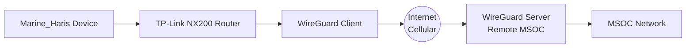

# WireGuard VPN Configuration

## 🏗️ **VPN Architecture Overview**



## 🖥️ **Server Configuration (Remote MSOC)**

### **Step 1: Install WireGuard**
```bash
# Install WireGuard on server
sudo apt install wireguard -y

# Generate server keys
wg genkey | sudo tee /etc/wireguard/privatekey | wg pubkey | sudo tee /etc/wireguard/publickey
```

### **Step 2: Create Server Config**
```ini
# /etc/wireguard/wg0.conf
[Interface]
Address = 10.0.0.1/24
SaveConfig = true
PostUp = iptables -A FORWARD -i wg0 -j ACCEPT; iptables -t nat -A POSTROUTING -o eth0 -j MASQUERADE
PostDown = iptables -D FORWARD -i wg0 -j ACCEPT; iptables -t nat -D POSTROUTING -o eth0 -j MASQUERADE
ListenPort = 51820
PrivateKey = <SERVER_PRIVATE_KEY>

[Peer]
PublicKey = <ROUTER_PUBLIC_KEY>
AllowedIPs = 10.0.0.2/32
```

### **Step 3: Enable Forwarding**
```bash
# Enable IP forwarding
sudo sysctl -w net.ipv4.ip_forward=1
echo "net.ipv4.ip_forward=1" | sudo tee -a /etc/sysctl.conf
```

## 📡 **Client Configuration (TP-Link NX200)**

### **Step 1: Access Router Interface**
1. Connect to router via Ethernet
2. Access web interface at `http://tplinkwifi.net`
3. Login with admin credentials

### **Step 2: Configure VPN Client**
1. Navigate to **VPN** → **WireGuard**
2. Click **Add New Profile**
3. Configure settings:

| Setting | Value | Notes |
|---------|-------|-------|
| Profile Name | MSOC_VPN | Descriptive name |
| Protocol | WireGuard | Modern VPN protocol |
| Server Address | your.public.ip | Your server's public IP |
| Server Port | 51820 | Default WireGuard port |
| Local Interface | 10.0.0.2 | Client VPN IP address |
| Local Port | 51820 | Matching port |
| Private Key | [Generated] | Click to generate |
| Peer Public Key | [From server] | Server's public key |
| Allowed IPs | 0.0.0.0/0 | Route all traffic |

### **Step 3: Save and Connect**
1. Click **Save**
2. Toggle connection to **On**
3. Verify connection status

## 🔐 **Security Best Practices**

### **Key Management**
- Store private keys securely
- Use different keys for each device
- Rotate keys periodically
- Never transmit private keys electronically

### **Network Security**
```bash
# On Raspberry Pi, restrict VPN access
sudo ufw allow from 10.0.0.0/24 to any port 22
sudo ufw allow from 10.0.0.0/24 to any port 3000
sudo ufw enable
```

## 🧪 **Connection Testing**

### **From Marine_Haris Device**
```bash
# Test VPN connectivity
ping 10.0.0.1  # Server VPN IP

# Check public IP (should show server IP)
curl ifconfig.me

# Test specific services
ssh user@10.0.0.1  # SSH to server
```

### **From Remote Server**
```bash
# Check connected peers
sudo wg show

# Ping client
ping 10.0.0.2
```

## 🚨 **Troubleshooting**

| Issue | Solution |
|-------|----------|
| No connection | Check firewall rules, verify keys |
| High latency | Use closer server, optimize MTU |
| Packet loss | Check cellular signal, adjust timeouts |
| DNS issues | Use VPN DNS or configure manually |

## 📊 **Monitoring**

### **Connection Monitoring**
```bash
# Check connection status
watch -n 5 'sudo wg show'

# Monitor traffic
sudo tcpdump -i wg0
```

### **Automated Checks**
```bash
# Add to crontab
*/5 * * * * /usr/local/bin/check_vpn.sh
```

## 🔄 **Maintenance**

### **Key Rotation Schedule**
- **Initial deployment**: Generate and store keys
- **Every 90 days**: Rotate keys for security
- **After compromise**: Immediate key regeneration

### **Backup Configuration**
```bash
# Backup WireGuard config
sudo cp /etc/wireguard/wg0.conf /etc/wireguard/wg0.conf.backup
```