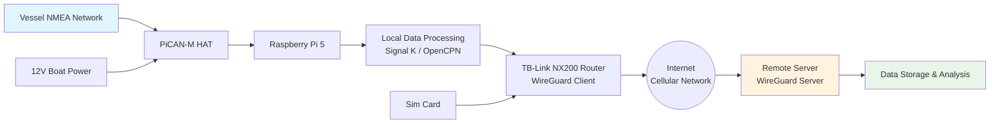

Based on your hardware and requirements, here is a comprehensive guide to building a marine data collection edge device with secure VPN communication.



## 📋 **System Overview & Architecture**

Your system consists of three main nodes:
1. **Edge Device (Vessel)**: Raspberry Pi 5 + PiCAN-M HAT + NVMe SSD
2. **Network Gateway**: TP-Link Archer NX200 with cellular connectivity
3. **Remote Server**: Machine with public IP running VPN server

**Data Flow**: Vessel NMEA 2000/0183 sensors → PiCAN-M → Raspberry Pi → Processing → WireGuard VPN → Remote Server

## 🔧 **Part 1: Hardware Assembly & Preparation**

### **Step 1.1: Mount the PiCAN-M HAT**


1. **Power off** your Raspberry Pi 5
2. Align the 40-pin header of the PICAN-M HAT with the Pi's GPIO header
3. Secure using included standoffs and screws 【turn0search0】
4. **Important**: Do not power on yet until wiring is complete

### **Step 1.2: Connect to Vessel NMEA Network**

<details>
<summary>🔧 **NMEA 2000 Wiring Details**</summary>

The NMEA 2000 interface uses a **Micro-C connector** with this pinout 【turn0search0】:

| Pin | Signal | Description |
|-----|--------|-------------|
| 1 | Shield | Cable shielding |
| 2 | +12 V | Power input (from NMEA backbone) |
| 3 | GND | Ground |
| 4 | CAN_H | CAN Bus High |
| 5 | CAN_L | CAN Bus Low |

**Connection Steps:**
1. Use a **drop cable** from your NMEA 2000 backbone to the PICAN-M's Micro-C connector
2. Ensure the backbone is properly **terminated** (typically 120 Ω at each end)
3. The PICAN-M includes a **120 Ω terminator** - enable it by soldering a 2-way header at **JP1** and inserting a jumper if your backbone isn't already terminated 【turn0search0】

</details>

<details>
<summary>⚙️ **NMEA 0183 Wiring (Optional)**</summary>

For legacy sensors, use the **5-way screw terminal** (J3) 【turn0search0】:

| Terminal | Signal | Usage |
|----------|--------|-------|
| IN – | Ground/RS-422 negative | Connect to sensor TX- |
| IN + | RS-422 positive input | Connect to sensor TX+ |
| OUT – | RS-422 negative output | For transmitting data |
| OUT + | RS-422 positive output | For transmitting data |
| GND | Ground reference | Common ground |

</details>

### **Step 1.3: Power Considerations**


The PICAN-M has an **onboard 3A SMPS** that can power the Raspberry Pi from the NMEA 2000 12V bus 【turn0search0】. However, **note this caveat**:

> ⚠️ **Power Warning**: Some users have reported that powering over the NMEA bus may exceed current specifications for the network, causing potential issues. A safer workaround is to cut the power line to the SMPS and use an **external 12V supply** instead 【turn0search0】.

**Recommendation**: For initial testing, use the onboard SMPS. For production deployment, consider an isolated 12V power supply if your NMEA network is sensitive.

### **Step 1.4: Storage Setup (NVMe SSD)**


Your 128GB NVMe SSD via Pimoroni NVMe Base provides ample storage for data logging. The Raspberry Pi 5 can boot directly from NVMe with proper configuration 【turn0search20】【turn0search21】.

## 💻 **Part 2: Software Configuration - Raspberry Pi**

### **Step 2.1: Install Raspberry Pi OS on NVMe**


Since you're building an edge device, I recommend a **headless setup** (no monitor/keyboard):

**Option A: Using Raspberry Pi Imager (Easiest)**
1. Connect the NVMe SSD to your computer (using a USB adapter if needed)
2. Use **Raspberry Pi Imager** to install **Raspberry Pi OS Lite (64-bit)** directly to the NVMe SSD
3. Before writing, click the "Advanced options" (gear icon) to:
   - Set hostname: `vessel-edge`
   - Enable SSH with password authentication
   - Configure wireless LAN (if needed for initial setup)
   - Set locale settings

**Option B: Command Line Method** 【turn0search22】
```bash
# Identify your NVMe drive (BE CAREFUL!)
lsblk

# Write Raspberry Pi OS Lite to NVMe
sudo dd if=raspios_lite_arm64.img of=/dev/nvme0n1 bs=4M status=progress conv=fsync
```

### **Step 2.2: Enable NVMe Boot on Raspberry Pi 5**

1. **Prepare a microSD card** with Raspberry Pi OS (for initial configuration)
2. Boot from microSD card first
3. Configure the Pi to boot from NVMe:

```bash
# Edit boot configuration
sudo nano /boot/firmware/config.txt

# Add this line at the end:
dtparam=nvme

# Update bootloader configuration
sudo rpi-eeprom-config --edit
# Change BOOT_ORDER to: BOOT_ORDER=0xf416
# Save and exit
```

4. Reboot, and the Pi should boot from NVMe 【turn0search20】【turn0search21】

### **Step 2.3: Configure NMEA Data Collection**


After wiring, configure the CAN interface on the Raspberry Pi:

```bash
# Install CAN utilities
sudo apt update
sudo apt install can-utils

# Configure CAN interface
sudo nano /boot/firmware/config.txt
```

Add these overlays 【turn0search0】:
```
dtparam=i2c_arm=on
dtparam=spi=on
dtoverlay=mcp2515-can0,oscillator=16000000,interrupt=25
dtoverlay=spi-bcm2835-overlay
```

```bash
# Reboot for changes to take effect
sudo reboot

# Bring up CAN interface
sudo ip link set can0 up type can bitrate 250000

# Test NMEA 2000 traffic
candump can0
```

You should see NMEA 2000 traffic flowing if connected correctly 【turn0search0】.

### **Step 2.4: Install Marine Data Software**


For comprehensive data collection, install **Signal K** or **OpenPlotter**:

```bash
# Install Signal K (recommended for flexibility)
curl -sL https://raw.githubusercontent.com/SignalK/signalk-server-node/master/scripts/install.sh | bash

# Or install OpenPlotter (more comprehensive marine solution)
sudo apt install openplotter
```

Signal K can:
- Collect NMEA 2000/0183 data
- Process and convert data formats
- Provide API endpoints for data extraction
- Store historical data

## 🌐 **Part 3: VPN Configuration - Secure Communication**

### **Step 3.1: VPN Architecture Overview**


Your VPN will use **WireGuard** for its efficiency and security:

- **Remote Server**: WireGuard **Server** (with public IP)
- **TP-Link NX200 Router**: WireGuard **Client** (connects to server)
- **Raspberry Pi**: Can be WireGuard client OR use router's VPN connection

**Topology Choice**: 
- **Option A**: Router as VPN client (all network traffic routed through VPN)
- **Option B**: Raspberry Pi as separate VPN client (more control)

I recommend **Option A** for simplicity - all devices on the vessel network automatically use the VPN.

### **Step 3.2: Configure Remote VPN Server**


On your remote machine (with public IP), install WireGuard:

```bash
# Install WireGuard
sudo apt install wireguard

# Generate server keys
wg genkey | sudo tee /etc/wireguard/privatekey | wg pubkey | sudo tee /etc/wireguard/publickey

# Create server configuration
sudo nano /etc/wireguard/wg0.conf
```

Add this configuration:
```ini
[Interface]
Address = 10.0.0.1/24
SaveConfig = true
PostUp = iptables -A FORWARD -i wg0 -j ACCEPT; iptables -t nat -A POSTROUTING -o eth0 -j MASQUERADE
PostDown = iptables -D FORWARD -i wg0 -j ACCEPT; iptables -t nat -D POSTROUTING -o eth0 -j MASQUERADE
ListenPort = 51820
PrivateKey = <SERVER_PRIVATE_KEY>

[Peer]
PublicKey = <ROUTER_PUBLIC_KEY>
AllowedIPs = 10.0.0.2/32
```

```bash
# Enable IP forwarding
sudo sysctl -w net.ipv4.ip_forward=1
# Make permanent
echo "net.ipv4.ip_forward=1" | sudo tee -a /etc/sysctl.conf

# Start WireGuard
sudo systemctl enable wg-quick@wg0
sudo systemctl start wg-quick@wg0
```

### **Step 3.3: Configure TP-Link NX200 Router**


The TP-Link Archer NX200 supports WireGuard client mode 【turn0search6】【turn0search8】. Configuration involves:

1. **Access router's web interface** (usually 192.168.1.1)
2. Navigate to **VPN** → **WireGuard Client**
3. Enable WireGuard client
4. Configure with these settings:
   - **Server Address**: Your remote server's public IP
   - **Server Port**: 51820 (default)
   - **Interface Address**: 10.0.0.2 (or similar from your VPN subnet)
   - **Private Key**: Generate from router interface
   - **Peer Public Key**: Your server's public key
   - **Allowed IPs**: 0.0.0.0/0 (route all traffic through VPN)

<details>
<summary>📖 **Detailed Router Configuration Steps**</summary>

Since specific TP-Link NX200 WireGuard configuration details weren't fully available in search results, here are general steps based on TP-Link VPN setup guides 【turn0search5】【turn0search7】:

1. **Log into router**: `http://tplinkwifi.net` or `192.168.1.1`
2. **VPN** → **WireGuard** → **Client**
3. **Add New Profile**:
   - Profile Name: `RemoteServer`
   - Protocol: `WireGuard`
   - Server Address: `your.public.ip.address`
   - Server Port: `51820`
   - Local Interface: `10.0.0.2` (or another address in your VPN subnet)
   - Local Port: `51820`
   - Private Key: (Generated by router)
   - Peer Public Key: (From your server's `/etc/wireguard/publickey`)
   - Allowed IPs: `0.0.0.0/0` (or specify subnets)
4. **Save** and **Connect**

</details>

### **Step 3.4: Verify VPN Connection**

1. **On the router**: Check VPN status in router admin panel
2. **From the vessel network**: 
   ```bash
   # SSH into Raspberry Pi
   curl ifconfig.me
   ```
   This should show your remote server's IP, not your vessel's cellular IP

## 📡 **Part 4: Data Transmission & Storage**

### **Step 4.1: Data Collection Strategy**


To "get as much data as possible" from the vessel, implement multiple collection methods:

<details>
<summary>📊 **Data Collection Methods**</summary>

| Method | Description | Tools |
|--------|-------------|-------|
| **NMEA 2000** | Modern marine network standard (CAN bus) | PiCAN-M HAT, Signal K |
| **NMEA 0183** | Legacy serial standard | PiCAN-M screw terminal, `ttyS0` |
| **GPS** | Position data | USB GPS or NMEA 2000 GPS sensor |
| **Environmental** | Temperature, humidity, pressure | Qwiic sensors (BME280 etc.) 【turn0search0】 |
| **Engine Data** | J1939, engine parameters | Additional CAN interfaces if needed |

</details>

### **Step 4.2: Configure Data Processing**

Install and configure **Signal K** for data aggregation:

```bash
# After installing Signal K
cd /usr/lib/node_modules/signalk-server

# Configure Signal K
nano .signalk/settings.json
```

Add configuration for NMEA 2000:
```json
{
  "interfaces": {
    "nmea2000": {
      "enabled": true,
      "type": "canbus",
      "interface": "can0"
    }
  },
  "plugins": {
    "signalk-to-influxdb": {
      "enabled": true,
      "host": "localhost",
      "database": "vessel_data"
    }
  }
}
```

### **Step 4.3: Set Up Data Transmission**

Configure data to be sent to your remote server:

```bash
# Install rsync for data synchronization
sudo apt install rsync

# Create a script to sync data to remote server
nano /usr/local/bin/sync_data.sh
```

```bash
#!/bin/bash
# Sync data to remote server via VPN
rsync -avz --delete /var/log/nmea/ user@10.0.0.1:/data/vessel/
```

```bash
# Make executable
chmod +x /usr/local/bin/sync_data.sh

# Set up cron job to sync every hour
crontab -e
```

Add:
```
0 * * * * /usr/local/bin/sync_data.sh
```

## 🔒 **Part 5: Security & Maintenance**

### **Step 5.1: Firewall Configuration**

On the Raspberry Pi:
```bash
# Install UFW firewall
sudo apt install ufw

# Allow SSH (from VPN only)
sudo ufw allow from 10.0.0.0/24 to any port 22

# Allow Signal K web interface
sudo ufw allow from 10.0.0.0/24 to any port 3000

# Enable firewall
sudo ufw enable
```

### **Step 5.2: Automatic Updates**

```bash
# Install unattended-upgrades
sudo apt install unattended-upgrades

# Configure automatic security updates
sudo dpkg-reconfigure -plow unattended-upgrades
```

### **Step 5.3: Monitoring & Alerts**

Set up monitoring for:
- **VPN connection status**
- **Data collection health**
- **Storage capacity**
- **System temperature**

```bash
# Example: Check VPN connection every 5 minutes
*/5 * * * * ping -c 1 10.0.0.1 > /dev/null || echo "VPN DOWN" | mail -s "VPN Alert" your@email.com
```

## 🚀 **Part 6: Testing & Validation**

### **Step 6.1: Local Testing**

1. **Check CAN interface**:
   ```bash
   ip link show can0
   candump can0
   ```

2. **Verify Signal K data**:
   - Access Signal K web interface at `http://vessel-edge:3000`
   - Check data is being received from NMEA sensors

3. **Test VPN connection**:
   ```bash
   # From Raspberry Pi
   curl ifconfig.me  # Should show remote server IP
   ping 10.0.0.1     # Should ping remote server via VPN
   ```

### **Step 6.2: Remote Testing**

1. **From remote server**, test connectivity to vessel:
   ```bash
   ping 10.0.0.2  # Router's VPN IP
   ```

2. **Check data reception**:
   ```bash
   # On remote server
   ls -la /data/vessel/
   tail -f /data/vessel/current_data.log
   ```

## 📊 **Performance Optimization Tips**

<details>
<summary>⚡ **Optimize for Marine Environment**</summary>

1. **Reduce power consumption**:
   - Use Raspberry Pi's power management features
   - Disable unused services
   - Consider underclocking if power is limited

2. **Cellular data optimization**:
   - Use data compression for transmission
   - Implement store-and-forward during connectivity loss
   - Configure different data collection rates for different data types

3. **Storage management**:
   - Implement log rotation
   - Use database for historical data (InfluxDB recommended)
   - Compress old data files

</details>

## 🛠️ **Troubleshooting Common Issues**

<details>
<summary>❓ **Common Problems & Solutions**</summary>

| Issue | Likely Cause | Solution |
|-------|--------------|----------|
| No NMEA data | Wiring issues, CAN interface down | Check wiring, verify CAN interface status |
| VPN won't connect | Keys mismatch, firewall blocking | Verify public keys, check firewall rules |
| Data not syncing | Permission issues, network problems | Check rsync permissions, verify VPN connectivity |
| System overheating | Poor ventilation, high load | Add heatsink, improve airflow, reduce processing load |
| Power issues | NMEA network overload | Use external 12V power supply 【turn0search0】 |

</details>

## 📈 **Advanced Features to Consider**

1. **Real-time monitoring dashboard**: Install Grafana for data visualization
2. **Alert system**: Configure alerts for critical vessel parameters
3. **Remote access**: Set up SSH tunneling for remote maintenance
4. **Data analytics**: Implement machine learning for predictive maintenance

## 🎯 **Quick Start Checklist**


- [ ] Assemble hardware (PiCAN-M + NVMe + router)
- [ ] Install Raspberry Pi OS on NVMe
- [ ] Configure NMEA data collection
- [ ] Set up Signal K or OpenPlotter
- [ ] Configure VPN server on remote machine
- [ ] Configure VPN client on TP-Link router
- [ ] Test end-to-end data flow
- [ ] Implement data synchronization
- [ ] Configure security (firewall, updates)
- [ ] Test failover scenarios

## 📚 **Additional Resources**

1. **PiCAN-M Documentation**: [Copperhill Tech Guide](https://copperhilltech.com/blog/how-to-wire-nmea-2000-with-the-picanm-raspberry-pi-hat-and-power-it-using-the-onboard-smps) 【turn0search0】
2. **WireGuard Setup**: [PiVPN Project](https://www.jeffgeerling.com/blog/2023/build-your-own-private-wireguard-vpn-pivpn) 【turn0search13】
3. **NVMe Boot Guide**: [Jeff Geerling's Blog](https://www.jeffgeerling.com/blog/2023/nvme-ssd-boot-raspberry-pi-5) 【turn0search20】
4. **Signal K Documentation**: [Signal K Official Site](https://signalk.org/)

This comprehensive guide should get your vessel data collection system operational with secure VPN connectivity. The system is designed to be robust for marine environments while providing maximum data collection capabilities. For production deployment, consider adding environmental monitoring (temperature, humidity) and power monitoring for system health.
